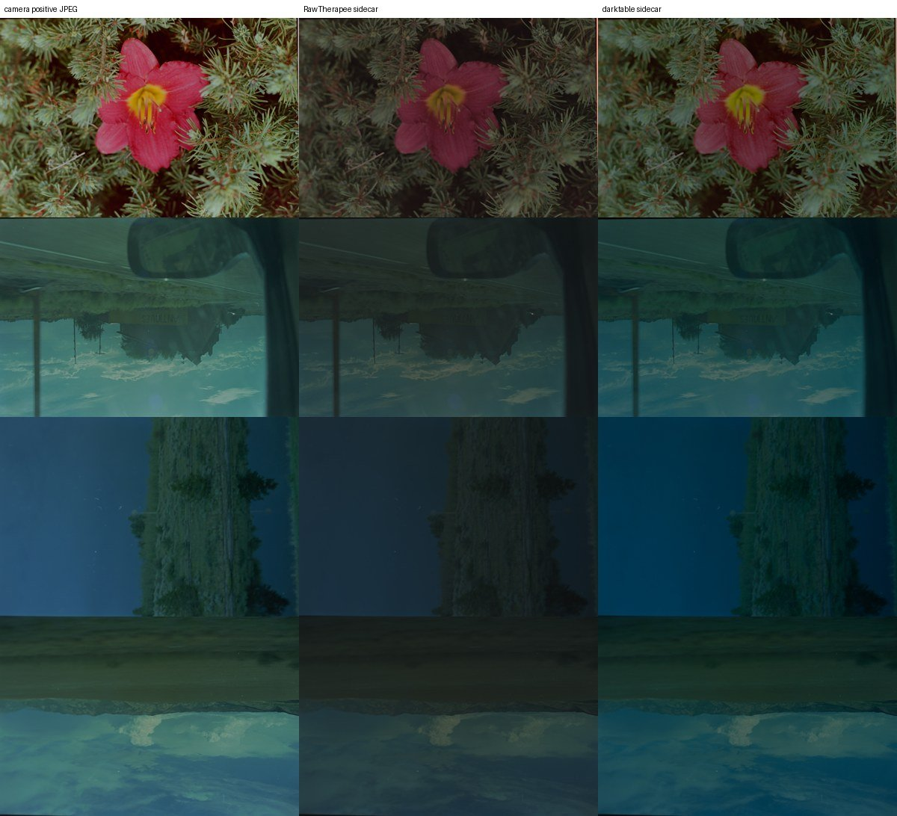

# Test reports

What was tested, on what, and what came out. The summary table is in the README ("What has been tested");
this file has the details. Newest first. Every release is published before its hardware testing finishes, and
its section here is updated as results come in.

## v0.29.3: release APKs signed with one project key (2026-11-24)

**Found while testing camera installs from Linux ARM64:** the install from the Debian 13 arm64 VM (camera
passed through by USB port) worked up to the camera's install step, then the camera answered "Communication
error 100" twice. Cause: CI signed every release APK with a newly generated key, and the camera (like Android)
only accepts an update signed with the key of the installed app. The same app signed with the key of the
earlier install went through: **camera install from Linux ARM64 works**, including the switch from Mass
Storage to install mode.

Fixed: CI signs release APKs with the project key (kept as a private GitHub Actions secret, not in the
repository). Self-built apps keep their own generated key; see "App signing" in the README. `install` now
explains error 100. (Tag v0.29.2 was pushed by mistake on the previous commit; its build was cancelled and it
has no release.) **Test pending:** install the v0.29.3 release APK over the app built on the owner's PC.

## v0.29.1: Linux executable setup fix (2026-11-24)

`setup` run from the Linux executable (not from source) failed on Debian 13 arm64: the programs it starts
inherited the executable's bundled libraries, so the system Python that builds the Sony-PMCA-RE environment
loaded the wrong SSL library and pip could not download anything. Child processes now get the original
library path back, a failed package install is retried on the next `setup`, and CI now runs `setup` from the
Linux executable. **Test on the ARM VM pending.**

## v0.29.0: camera clock fix (2026-11-24)

The app's log and the "measured" date of saved films were 6 hours behind the camera's own clock (the
camera's time-zone offset, applied twice). Now they use the camera's local clock, as on its file times.
**Camera test pending.**

## v0.28 on the camera (a6500, 2026-11-24)

| Test | Result |
|---|---|
| Menu › Film: the earlier base measurement became the saved film "Kodak Ektacolor Pro 160" and loads at start | ✅ |
| Save › RAW only, JPEG only, RAW+JPEG: each saves the right files; the setting is restored on exit | ✅ |
| Sidecars › Lightroom / darktable / RawTherapee / all three: the right files next to each RAW (`.XMP`, `.DTX`, `.PP3`) | ✅ |
| Sidecars with JPEG only: none written, and the menu says so | ✅ |
| `filminverter sidecars <folder>` on the copied card folder (adds darktable's as-shot white balance) | ✅ |
| darktable 5.6 and RawTherapee 5.13 open the camera-written sidecars as positives (command-line render) | ✅ see below |
| Lightroom Classic | ❓ |
| Device line in the log (model, firmware, Android, API; no serial number) | ✅ |
| Clean exit | ✅ |
| Check alignment with no film edge in the frame | ✅ says to include some rebate |
| Log timestamps | ❌ 6 h behind the camera clock; fixed in v0.29.0 |

Sidecars on Kodak Ektacolor Pro 160 (the owner's roll; sheet made during tuning): the camera's own positive
JPEG, then RawTherapee and darktable opening the RAW with only the sidecar applied. They are starting points,
flatter than the camera's JPEG; levels are set per frame in the editor.

## v0.28.2: Linux ARM64 (2026-11-24)

**Machine:** Debian 13 (trixie) arm64 VM, 16 cores, 8 GB RAM, Python 3.13.5. The VM's CPU is emulated by
QEMU on an x86 host (no KVM), so it checks correctness, not speed: everything runs several times slower
than on real ARM hardware.

| Test | Result |
|---|---|
| `pip install numpy pillow rawpy pytest` (arm64 wheels exist for all) | ✅ |
| Engine tests (`pytest engine/tests`, 11 tests) | ✅ |
| `doctor` | ✅ names `python3-tk` and the udev rule when missing |
| Smoke test from source (CLI, themes, develop a synthetic negative) | ✅ |
| GUI from source (virtual display) | ✅ |
| `setup` | ✅ after the fix below |
| `build PMCADemo`, `build` (camera app) | ✅ the APK's contents are identical, file for file, to the Windows build (only the signature differs) |
| Executable (`tool/package.py`): smoke test | ✅ |
| Executable GUI | ✅ after the fix below |
| Released `filminverter-linux-arm64`: `doctor`, smoke test, GUI | ✅ |
| Released executable: `setup` picks the system aapt/zipalign/adb on aarch64 | ✅ (downloads still running at the time of writing) |
| Released executable: `build` | by design needs a source checkout; says so |
| Camera USB install | ❓ not tried (the VM has no camera passed through) |

**Fixed in this release:**
- Google's `aapt`, `zipalign` and `adb` exist only for x86_64 Linux, so on ARM `setup` now uses the
  distribution's native builds (Debian/Ubuntu: `sudo apt install aapt zipalign adb`) and stops with that
  command if they are missing. Everything else in the Android SDK is Java and works as downloaded.
- An executable built on a machine without Tk had no GUI. `tool/package.py` now refuses to build without Tk.

**CI added:** a Linux ARM64 executable and APK build (GitHub's arm64 runners), a Windows ARM64 executable
(GitHub's Windows 11 ARM runners), and every executable now opens its GUI in CI, not only the smoke test.

**Not possible here:** a Windows or macOS VM inside this ARM VM. It has no hardware virtualization (it is
itself emulated), and macOS for Apple chips only runs in VMs on Apple hardware. Windows ARM is covered by the
CI runners above, and macOS on Apple chips by GitHub's macOS runners.
